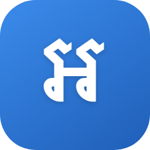
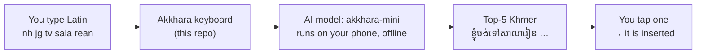
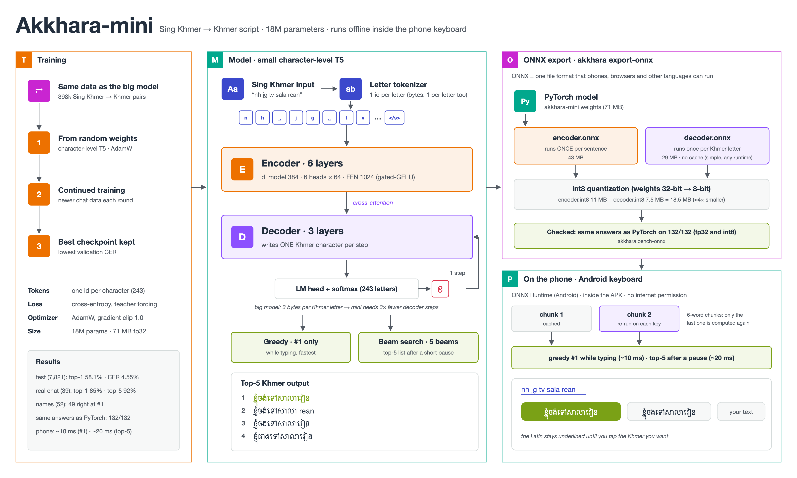
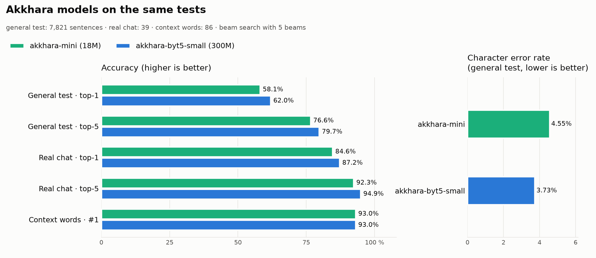

<div align="center">



# Akkhara Keyboard

**Type Khmer the way you chat: Sing Khmer → ខ្មែរ**

An Android keyboard with on-device AI: type romanized Khmer (`nh jg tv sala rean`) and pick the
Khmer (`ខ្ញុំចង់ទៅសាលារៀន`) from the top-5 suggestions. Works offline.

[](LICENSE)
[](https://github.com/MuyleangIng/akkhara-keyboard/releases/latest)
[](https://huggingface.co/INGMUYLEANG/akkhara-mini)
[](https://huggingface.co/spaces/INGMUYLEANG/akkhara-demo)

</div>

---

| You type | Akkhara suggests (#1) |
|---|---|
| `nh jg tv sala rean` | ខ្ញុំចង់ទៅសាលារៀន |
| `b pg lvol ot torn tomne te o` | បងកំពុងរវល់អត់ទាន់ទំនេរទេអូន |
| `tos jol CG` | តោះចូល CG |
| `sok sbay ot bro` | សុខសប្បាយអត់ bro |

Sing Khmer has no standard spelling (`knhom` / `knh` / `nh` all mean ខ្ញុំ), and short words
depend on context (`tos` = តោះ / ទោះ / ទោស). Akkhara reads the whole sentence to choose the right
Khmer, and keeps English chat words (`bro`, `game`) as they are.

## Features

- **Three keyboards in one**: *Sing Khmer* (type Latin, pick Khmer), *ខ្មែរ* (standard NiDA Khmer
  layout) and *English*. Tap the globe key to switch; hold it for your other keyboard.
- **On-device AI**: an 18 MB model runs on the phone (~10 ms per key on a recent flagship).
  No internet permission — nothing you type leaves your phone.
- **You stay in control**: your Latin stays underlined until you tap the Khmer you want.
- **Fix any word**: tap inside the underlined text to edit a single word.
- **Keep as typed**: one tap keeps names or English words exactly as you wrote them.
- **Familiar layout**: number row, `!#1` symbols (2 pages, with ៛), corner hints (hold a key for its
  symbol), `.` / `,` extras (។ ៕ ៖ ៗ), and the bottom row `!#1 · 🌐 · , · space · . · ⏎`.
- **Toolbar**: emoji (search with Sing Khmer words: `sok`, `srolanh`), clipboard, mode switch,
  one-hand mode, settings. It turns into the suggestion bar while you type; ⌄ shows all 5.
- **Private clipboard**: kept only on your phone, unpinned items deleted after 1 hour; passwords
  and items marked sensitive are never saved; codes and account numbers stay hidden until tapped.
- **Typing feel**: key preview, hold ⌫ to delete whole words, hold space and slide to move the
  cursor, two-thumb typing, system haptics, optional key sound, TalkBack support.
- **Dictionary**: hold a Khmer suggestion to see what each word means (Khmer → English, ~9k words,
  offline, from Wiktionary); the app has a Dictionary search too.
- The mode is remembered per app; password fields get no suggestions.
- Light / dark mode, keyboard height Small / Normal / Large, ➤ send key in chat apps.

## How it works



1. **You type** Sing Khmer with Latin letters; the keyboard keeps it underlined.
2. **The AI model** reads the whole sentence and writes the Khmer letter by letter, keeping the
   5 best sentences.
3. **You choose** the right one; nothing changes until you tap it.

This repository contains the **keyboard app**. The AI model is trained separately and published
on Hugging Face: **[INGMUYLEANG/akkhara-mini](https://huggingface.co/INGMUYLEANG/akkhara-mini)**
— see its model card for how it was trained, the evaluation results and the license.

## Install

1. Download **`Akkhara-<version>.apk`** from the
   [latest release](https://github.com/MuyleangIng/akkhara-keyboard/releases/latest).
2. Open the file on your phone and allow *Install unknown apps* (one time).
3. Open **Akkhara**: **① Turn on Akkhara** → **② Choose Akkhara** → **③ Try it**.

Android 8.0 or newer. Android shows a standard notice that any keyboard *could* collect typed
text; Akkhara has no internet access, so it cannot send anything.

## How to type

| Key | What it does |
|---|---|
| letters, space | *Sing Khmer*: the Latin collects underlined; Khmer suggestions appear on top |
| tap a Khmer suggestion | inserts it in place of the Latin |
| “your text” chip | keeps exactly what you typed |
| ⏎ , . | insert the first suggestion |
| tap inside the underlined text | edit any word |
| 🌐 tap / hold | next keyboard (Sing → ខ្មែរ → English) / other phone keyboard |
| ⇧ once / twice | one capital (second layer on ខ្មែរ) / CAPS |
| hold a letter | its corner symbol (or more); slide and lift to pick |
| hold ⌫ / hold space + slide | delete whole words / move the cursor |
| `!#1` | symbols (1/2 → 2/2); `abc` / `កខគ` goes back |
| ⌄ on the suggestion bar | the full top-5 list |

## The model

The keyboard uses **[akkhara-mini](https://huggingface.co/INGMUYLEANG/akkhara-mini)**, a small
character-level Transformer (18M parameters) exported to ONNX and quantized to 8-bit (18.5 MB).
It is built into the APK, so you do not need to download anything.



All Akkhara models on the same tests (green = the phone model, blue = the big model):



| | Real chat (39 sentences): top-1 / top-5 | Speed on phone |
|---|---|---|
| **akkhara-mini** (latest, in the app since 0.11.0) | **85% / 92%** · names 49/52 | ~10 ms (#1) · ~20 ms (top-5) |

`scripts/get_model.sh` downloads the same model, so a build from source uses it too.

**On a computer?** [Akkhara Desktop](https://github.com/MuyleangIng/akkhara-desktop) (test app) uses the same
model on Mac and Windows: press a hotkey in any app, type Sing Khmer, get Khmer.

The [web demo](https://huggingface.co/spaces/INGMUYLEANG/akkhara-demo) uses the same model by default; a larger
model ([akkhara-byt5-small](https://huggingface.co/INGMUYLEANG/akkhara-byt5-small), 300M, real chat top-1 87%, best on formal text) is in its menu. Model weights are
open to download on Hugging Face.

## Build from source

Requirements: Java 17 and Android SDK 35 (command-line tools are enough). The
[akkhara-mini](https://huggingface.co/INGMUYLEANG/akkhara-mini) model is open: no Hugging Face account needed.

```bash
git clone https://github.com/MuyleangIng/akkhara-keyboard.git && cd akkhara-keyboard
bash scripts/get_model.sh           # → models/akkhara-mini/onnx (int8 model + tokenizer, ~18.5 MB)
export ANDROID_HOME=~/Library/Android/sdk   # where your Android SDK is (Linux: ~/Android/Sdk)
cd android && ./gradlew assembleDebug
adb install -r app/build/outputs/apk/debug/app-debug.apk
```

**Project layout**

```
android/app/src/main/java/com/akkhara/keyboard/
  AkkharaIME.kt      the keyboard service: typing logic, candidates, editing
  KeyboardView.kt    candidate bar + vibration
  KeysView.kt        all keys drawn on one canvas (Sing / ខ្មែរ NiDA / English layouts)
  MiniModel.kt       ONNX Runtime: tokenizer, encoder, greedy + beam search
  LiveEngine.kt      6-word chunks + cache for live typing
  MainActivity.kt    setup screen (turn on, choose, try, speed test, settings)
scripts/get_model.sh download the model files the build copies into the app
```

## Contributing

Bug reports, layout ideas and real Sing Khmer spellings are very welcome — see
[CONTRIBUTING.md](CONTRIBUTING.md).

## License

Code: [Apache License 2.0](LICENSE) © 2026 Ing Muyleang. The built-in dictionary
(`android/app/src/main/assets/dict/`) comes from [Wiktionary](https://en.wiktionary.org) and is
[CC BY-SA 4.0](https://creativecommons.org/licenses/by-sa/4.0/) (see its NOTICE.txt). The model is licensed separately
(Apache-2.0, open download) on [Hugging Face](https://huggingface.co/INGMUYLEANG/akkhara-mini).

## Contact

Questions about training details or hardware: contact the author through the [Hugging Face profile](https://huggingface.co/INGMUYLEANG) or [GitHub](https://github.com/MuyleangIng).

## Citation

```bibtex
@misc{akkhara2026keyboard,
  author    = {Ing, Muyleang},
  title     = {Akkhara Keyboard: on-device Sing Khmer to Khmer script input},
  year      = {2026},
  publisher = {GitHub},
  url       = {https://github.com/MuyleangIng/akkhara-keyboard}
}
```
